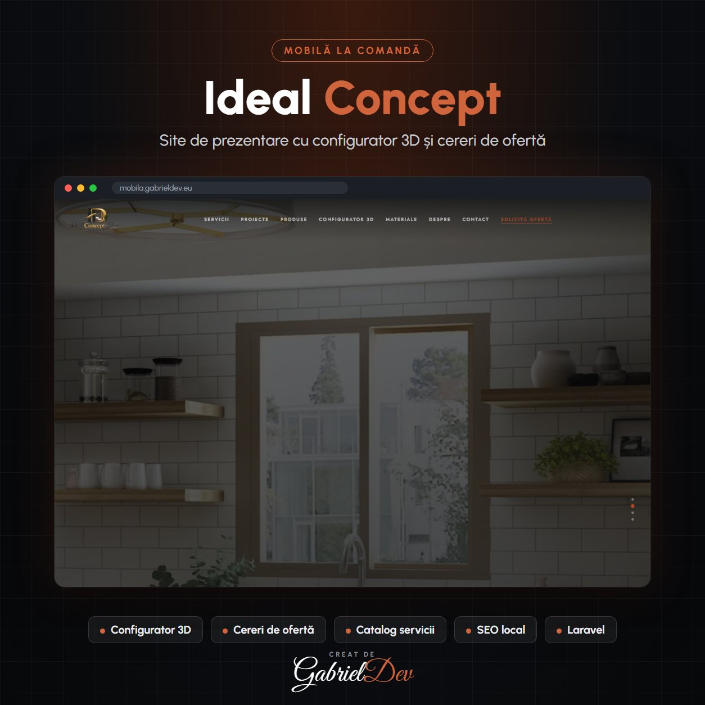

  

<h1 align="center">Ideal Concept Design – Site Mobilă la Comandă cu Configurator 3D</h1>

Website pentru un atelier de mobilă la comandă: configurator 3D, catalog de servicii pe camere, prețuri orientative, materiale, portofoliu și cereri de ofertă, cu SEO pe fiecare serviciu.

| | |
|---|---|
| **Client** | Ideal Concept Design |
| **An** | 2026 |
| **Domeniu** | Backend Development · Frontend Development · Aplicații Web Personalizate |
| **Status** | Live — [mobila.gabrieldev.eu](https://mobila.gabrieldev.eu) |
| **Studiu de caz** | [gabrieldev.eu](https://gabrieldev.eu/portofoliu/ideal-concept-design-mobila-la-comanda-configurator-3d) |

---

## Clientul își vede mobila înainte să o comande

Ideal Concept Design este un atelier de mobilă la comandă: bucătării, dressinguri, living, dormitoare, băi și mobilier comercial, cu proiectare, producție și montaj în echipă proprie. Site-ul trebuia să arate premium și să aducă **cereri de ofertă calificate**.

## Funcționalități implementate

- **Configurator 3D**: clientul alege tipul de mobilier, dimensiunile și finisajele iar modelul 3D se actualizează în timp real (rotire, zoom, estimare orientativă de preț)
- Catalog de servicii pe camere: bucătării, dressinguri, living, dormitor, baie, mobilier comercial
- **Prețuri orientative** pentru fiecare categorie, ca vizitatorul să știe de la ce buget pornește
- Pagini de materiale, proces de lucru și portofoliu de proiecte
- Configurația se trimite direct pentru ofertă, cu număr de referință, sau se descarcă drept imagine
- Formular de solicitare ofertă pe fiecare serviciu
- Blog și întrebări frecvente
- Banner de consimțământ cookie conform GDPR, cu opțiuni separate pentru statistici și marketing

## SEO

- Pagină dedicată fiecărui serviciu („bucătării la comandă”, „dressinguri la comandă” etc.), pe cuvintele căutate de clienți
- Structură de URL-uri clară, titluri și meta descrieri optimizate
- Conținut despre prețuri și proces, cu întrebări frecvente marcate cu date structurate FAQPage
- Imagini optimizate și încărcare rapidă pe mobil

## Tehnologii utilizate

- Laravel, PHP 8.2
- Vite, JavaScript, WebGL pentru randarea 3D în browser
- MySQL, server LiteSpeed
- Git pentru versionare

## Rezultatul

Un site care vinde înainte de prima discuție: clientul vine deja cu o idee clară și un buget, iar atelierul primește cereri de ofertă mai bune.

---

## 🔒 Despre cod

Acesta este un repository de **prezentare**. Codul sursă aparține clientului și nu este public — aici găsești descrierea proiectului, funcționalitățile și tehnologiile folosite.

## 🤝 Ai nevoie de ceva asemănător?

Proiect realizat de **[Gabriel Dev](https://gabrieldev.eu)** — creare site-uri, magazine online și aplicații web personalizate.

- 🌐 [gabrieldev.eu](https://gabrieldev.eu) · [toate proiectele](https://gabrieldev.eu/proiecte)
- ✉️ [contact@gabrieldev.eu](mailto:contact@gabrieldev.eu)
- 📞 [+40 743 543 100](tel:+40743543100)
